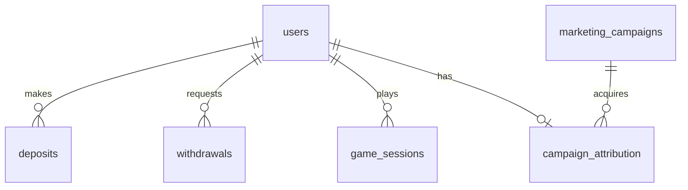

# Data dictionary and relationships

All amounts are integer KRW. Dates are `DATE`, not timestamps. Clean columns are non-null. Synthetic IDs are BIGINT; session duration is NUMERIC(8,2) in PostgreSQL.

| Table / grain | Columns and interpretation |
|---|---|
| users: one account | `user_id` PK; `registration_date`; `country` KR/JP/TW/CA/NZ/UNKNOWN; `acquisition_channel` organic/paid_search/social/affiliate/influencer; `device_type` mobile/desktop/tablet; `account_status` active/closed/suspended, final snapshot |
| deposits: one attempt | `deposit_id` PK; `user_id` FK; `amount_krw` positive; `transaction_date`; `payment_status` success/failed/pending |
| withdrawals: one attempt | `withdrawal_id` PK; `user_id` FK; `amount_krw` positive; `transaction_date`; `payment_status` success/failed/pending |
| game_sessions: one settled session | `session_id` PK; `user_id` FK; `game_type` slots/live_casino/sports/table_games; `session_date`; `bet_amount_krw` positive aggregate stakes; `win_amount_krw` nonnegative aggregate payouts including returned stakes; `session_duration_minutes` 1–240 |
| marketing_campaigns: one monthly channel campaign | `campaign_id` PK; `channel` paid_search/social/affiliate/influencer; `campaign_start_date`; `campaign_end_date` inclusive; `campaign_cost_krw` |
| campaign_attribution: one attributed account | `user_id` PK+FK; `campaign_id` FK. Organic users have no row |

## Derived relations

- `calendar`: one row per observed day, including leap day and zero-activity dates.
- `activity`: one row per distinct user/day with gameplay.
- `revenue_ledger`: union of session events (stakes, payouts, GGR) and successful-deposit events (bonus expense). Shared user/date fields, no independent-fact joins.
- `monthly_revenue`: one row per observed month; bets, wins, GGR, bonus, NGR.

Foreign keys prevent orphan facts. User-date indexes support retention and lifetime joins. Dates and attribution consistency are validated in the Python staging step; SQL table checks cover local invariants. The small portfolio model does not implement slowly changing dimensions or incremental merges.
